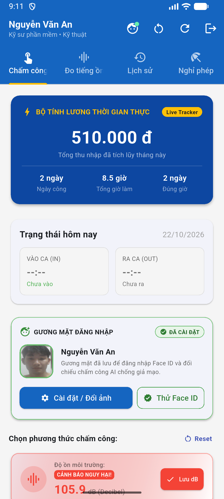
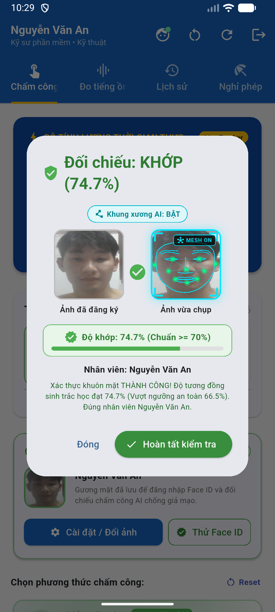
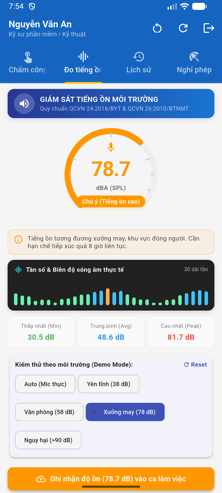
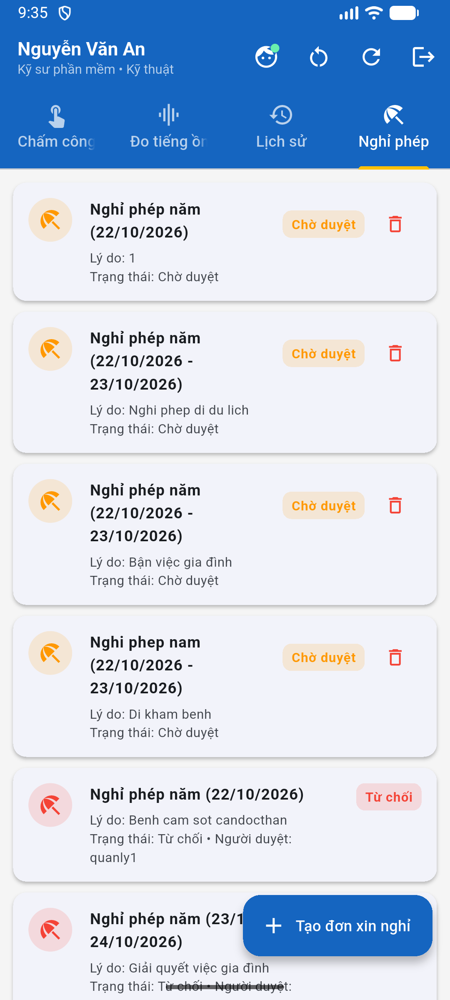
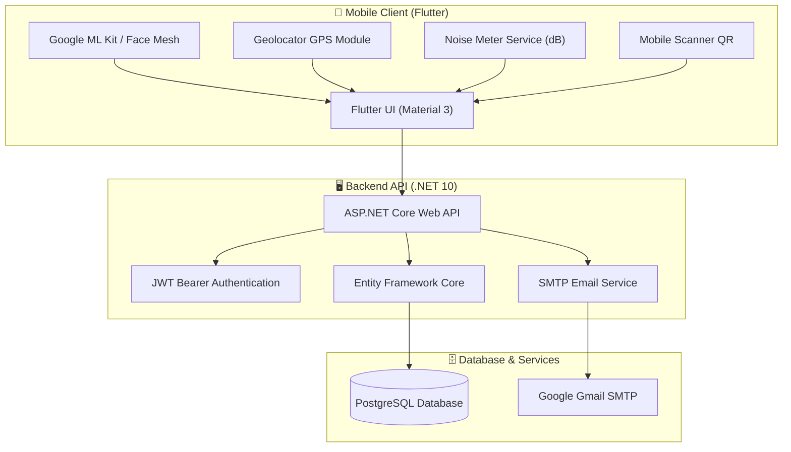

# 🏢 HỆ THỐNG CHẤM CÔNG THÔNG MINH (SMART ATTENDANCE SYSTEM)

<div align="center">


**Giải pháp chấm công đa phương thức tích hợp Trí tuệ nhân tạo (Face AI Biometric), Định vị vị trí vệ tinh (GPS Geofencing), Quét mã QR động (Dynamic QR Code) và Giám sát ô nhiễm tiếng ồn môi trường làm việc thời gian thực.**

</div>

---

## 📸 Hình ảnh giao diện ứng dụng

<div align="center">
  <table>
    <tr>
      <td align="center"><b>🔐 Màn hình Đăng nhập & Phân quyền</b></td>
      <td align="center"><b>💼 Dashboard Nhân viên & Bộ tính lương</b></td>
    </tr>
    <tr>
      <td></td>
      <td></td>
    </tr>
    <tr>
      <td align="center"><b>👤 Xác thực Face Mesh 3D AI Biometric</b></td>
      <td align="center"><b>🔊 Giám sát ô nhiễm tiếng ồn (78.7 dB)</b></td>
    </tr>
    <tr>
      <td></td>
      <td></td>
    </tr>
    <tr>
      <td align="center"><b>👥 Quản trị Nhân sự Admin (CRUD)</b></td>
      <td align="center"><b>⏰ Thiết lập Ca trực & Đơn giá (Manager)</b></td>
    </tr>
    <tr>
      <td></td>
      <td></td>
    </tr>
    <tr>
      <td align="center"><b>📊 Lịch sử chấm công & Cảm biến</b></td>
      <td align="center"><b>📝 Quản lý & Phê duyệt Đơn nghỉ phép</b></td>
    </tr>
    <tr>
      <td></td>
      <td></td>
    </tr>
  </table>
</div>

---

## 📑 Mục lục
1. [Tổng quan dự án](#-tổng-quan-dự-án)
2. [Tính năng nổi bật](#-tính-năng-nổi-bật)
3. [Kiến trúc hệ thống & Công nghệ sử dụng](#-kiến-trúc-hệ-thống--công-nghệ-sử-dụng)
4. [Cấu trúc mã nguồn](#-cấu-trúc-mã-nguồn)
5. [Quy trình hoạt động](#-quy-trình-hoạt-động)
6. [Hướng dẫn cài đặt & Khởi chạy](#-hướng-dẫn-cài-đặt--khởi-chạy)
7. [API Endpoints Documentation](#-api-endpoints-documentation)
8. [Tác giả](#-tác-giả)

---

## 🌟 Tổng quan dự án

Dự án **Hệ Thống Chấm Công Thông Minh** được phát triển nhằm giải quyết triệt để các nhược điểm của phương thức chấm công truyền thống (thẻ từ, vân tay cơ học dễ hỏng hoặc dễ gian lận quẹt thẻ hộ). 

Hệ thống kết hợp giữa **Ứng dụng di động Flutter** đa nền tảng và **Máy chủ Backend ASP.NET Core Web API**, mang lại trải nghiệm chấm công hiện đại, bảo mật cao và tiện ích giám sát môi trường lao động:
- **Độ tin cậy tuyệt đối:** Kết hợp đồng thời 3 yếu tố xác thực: *Ai đang chấm công* (Face AI), *Chấm công ở đâu* (GPS Geofence), và *Có mặt thực tế tại thời điểm quét* (Dynamic QR).
- **Chăm sóc sức khỏe nhân viên:** Tích hợp bộ cảm biến đo độ ồn thời gian thực cảnh báo nguy cơ ô nhiễm tiếng ồn tại xưởng sản xuất/văn phòng.
- **Sẵn sàng triển khai:** Đóng gói toàn bộ hệ thống bằng Docker Compose chỉ với một lệnh khởi chạy.

---

## 🚀 Tính năng nổi bật

### 1. 👤 Chấm công nhận diện khuôn mặt (Face AI Biometric)
- Tích hợp công nghệ nhận diện khuôn mặt thời gian thực từ camera thiết bị.
- Hiển thị lưới **Face Mesh Overlay** trực quan trên giao diện khi quét mặt.
- Xác thực vị trí mắt, mũi, góc quay khuôn mặt chống gian lận dùng hình ảnh/video tĩnh (Liveness Detection).

### 2. 📍 Định vị địa lý thông minh (GPS Geofencing)
- Tự động lấy tọa độ kinh độ/vĩ độ (Latitude, Longitude) chính xác qua GPS vệ tinh.
- Thuật toán tính khoảng cách (Haversine Formula) so với tọa độ trụ sở công ty / nhà máy.
- Chỉ chấp nhận chấm công khi nhân viên nằm trong bán kính quy định (ví dụ: $R \le 100\text{m}$).

### 3. 🔳 Mã QR động chống gian lận (Dynamic QR Code)
- Hỗ trợ chấm công bằng cách quét mã QR tại quầy tiếp tân hoặc từng phân xưởng.
- Mã QR được làm mới định kỳ chống việc chụp ảnh mã gửi cho người khác chấm công hộ.

### 4. 🔊 Giám sát ô nhiễm tiếng ồn thời gian thực (Noise Level Meter)
- Thu nhận tín hiệu âm thanh môi trường qua micro thiết bị và tính toán cường độ theo đơn vị Decibel (**dB**).
- Hiển thị biểu đồ dạng sóng âm thanh (Waveform Visualizer) trực tiếp theo thời gian thực.
- Cảnh báo màu trực quan:
  - 🟢 **An toàn (< 60 dB):** Không gian văn phòng, yên tĩnh.
  - 🟡 **Trung bình (60 - 85 dB):** Tiếng ồn văn phòng lớn, tiếng nói chuyện đông người.
  - 🔴 **Nguy hiểm (> 85 dB):** Tiếng ồn máy móc công nghiệp, vượt ngưỡng an toàn lao động OSHA.

### 5. 👥 Phân quyền người dùng đa cấp (RBAC)
- **Nhân viên (Employee):** Check-in, Check-out, xem bảng công theo tuần/tháng, gửi đơn xin nghỉ phép, giám sát mức ồn môi trường.
- **Quản lý (Manager):** Giám sát nhân sự trong phòng ban, theo dõi tình trạng đi trễ/về sớm, quản lý thiết lập ca làm việc (Shift CRUD: xem, thêm, sửa, xóa ca), duyệt đơn nghỉ phép.
- **Quản trị viên (Admin):** Quản lý hồ sơ nhân viên (CRUD Employee), giám sát bảng chấm công toàn công ty, phê duyệt đơn nghỉ phép, cấu hình hệ thống.

### 6. 📧 Dịch vụ thông báo & Xác thực Email
- Tích hợp gửi mã OTP xác nhận tài khoản qua Google SMTP Server.
- Gửi thông báo kết quả chấm công và phê duyệt đơn nghỉ phép tự động.

---

## 🏗 Kiến trúc hệ thống & Công nghệ sử dụng



### Công nghệ chính:
| Thành phần | Công nghệ / Thư viện |
|---|---|
| **Mobile Client** | Flutter SDK 3.x, Dart, Provider / State Management |
| **Thư viện Client** | `camera`, `geolocator`, `noise_meter`, `mobile_scanner`, `http`, `flutter_secure_storage` |
| **Backend Server** | C# .NET 10.0, ASP.NET Core Web API |
| **Cơ sở dữ liệu** | PostgreSQL 16 Alpine, Entity Framework Core (Npgsql) |
| **Bảo mật** | ASP.NET Core Identity, JWT (JSON Web Token), Password Hashing |
| **Tài liệu API** | Swagger / OpenAPI 3.0 |
| **Container & CI/CD**| Docker, Docker Compose, Nginx (Flutter Web Reverse Proxy) |

---

## 📂 Cấu trúc mã nguồn

```plaintext
bt/
├── BuiNguyenCongNghiep_ChamCong.sln   # Visual Studio Solution tổng thể
├── Chay_Backend_WebAPI.bat            # Script khởi chạy nhanh Backend (Port 5000)
├── Chay_May_Ao.bat                    # Script khởi chạy máy ảo Android & Flutter App
├── docker-compose.yml                 # Cấu hình cụm Docker (Database + Backend + Frontend)
├── reset_today.py                     # Script Python hỗ trợ reset dữ liệu chấm công test
├── screen_launch.png                  # Ảnh chụp màn hình ứng dụng (Đăng nhập)
├── screen_dashboard.png               # Dashboard nhân viên & bộ tính lương
├── screen_facemesh.png                # Xác thực khuôn mặt 3D Face Mesh AI
├── screen_noise_tab.png               # Cảm biến độ ồn môi trường 78.7 dB
├── screen_admin_employees.png         # Quản trị Admin CRUD nhân viên
├── screen_shifts.png                  # Quản lý ca trực Manager Shift
├── screen_history.png                 # Lịch sử chấm công
├── screen_leaves.png                  # Đơn xin nghỉ phép
│
├── Sang6_WebAPI/                      # Thư mục mã nguồn Backend ASP.NET Core
│   ├── Controllers/                   # Các bộ điều khiển API RESTful
│   │   ├── AttendanceController.cs    # Xử lý check-in, check-out, vị trí, face, tiếng ồn
│   │   ├── AuthController.cs          # Đăng nhập, đăng ký, cấp JWT, OTP
│   │   ├── EmployeeController.cs      # Quản lý hồ sơ nhân viên
│   │   ├── LeaveRequestController.cs  # Đơn xin nghỉ phép
│   │   └── ShiftController.cs         # Ca làm việc
│   ├── Data/                          # DbContext và cấu hình Entity Framework
│   ├── Models/                        # Entity models (AppUser, Attendance, Shift...)
│   ├── Repositories/                  # Pattern phân tầng dữ liệu
│   ├── Services/                      # EmailService, FaceBiometricService...
│   ├── appsettings.json               # Cấu hình chuỗi kết nối, JWT Key, SMTP
│   ├── Dockerfile                     # Docker build cho Backend .NET
│   └── Program.cs                     # Khởi tạo DI, Pipeline, CORS, Swagger
│
└── fb_interface/                      # Thư mục mã nguồn Frontend Flutter
    ├── lib/
    │   ├── main.dart                  # Điểm khởi chạy ứng dụng Flutter
    │   ├── config/                    # Cấu hình BASE_URL (Local / Emulator / Production)
    │   ├── models/                    # Data models định nghĩa phía Dart
    │   ├── screens/                   # Các màn hình chính (Login, Dashboard, Admin...)
    │   ├── services/                  # ApiClient, AuthService, ChamCongService, NoiseMeter
    │   ├── utils/                     # Hằng số, Face samples, Authentication helpers
    │   └── widgets/                   # FaceMeshOverlay, NoiseMeterWidget biểu đồ sóng
    ├── android/                       # Cấu hình Android native (Permissions, Manifest)
    ├── pubspec.yaml                   # Khai báo thư viện phụ thuộc Flutter
    └── Dockerfile                     # Nginx build cho Flutter Web
```

---

## 🔄 Quy trình hoạt động

1. **Đăng nhập & Xác thực:**
   - Nhân viên nhập tài khoản hoặc đăng ký mới (nhận mã OTP kích hoạt qua Email).
   - Hệ thống trả về JWT Token và thông tin phân quyền người dùng.
2. **Thực hiện Chấm công:**
   - Nhân viên chọn phương thức (Khuôn mặt AI / GPS / QR Code).
   - Ứng dụng bật Camera và lấy vị trí GPS cùng lúc.
   - Micro thu thập mẫu tiếng ồn môi trường làm việc trong quá trình chấm công.
   - Gói dữ liệu gửi lên API: `{ Latitude, Longitude, FaceVerified, NoiseLevelDb, Method }`.
3. **Xử lý tại Máy chủ:**
   - Kiểm tra tính hợp lệ của JWT Token.
   - Đối chiếu khoảng cách GPS với tọa độ địa điểm làm việc đã đăng ký.
   - Ghi nhận thời gian Check-in / Check-out, tính toán đi muộn / về sớm.
   - Lưu trữ dữ liệu tiếng ồn để phục vụ thống kê môi trường làm việc.

---

## 🛠 Hướng dẫn cài đặt & Khởi chạy

### Cách 1: Khởi chạy nhanh bằng Script tự động (Khuyên dùng trên Windows)

1. **Khởi chạy Backend Web API:**
   - Click đúp vào file `Chay_Backend_WebAPI.bat`.
   - Máy chủ sẽ lắng nghe tại `http://localhost:5000`.
   - Truy cập Swagger API: `http://localhost:5000/swagger`.

2. **Khởi chạy Máy ảo & App Flutter:**
   - Click đúp vào file `Chay_May_Ao.bat`.
   - Hệ thống tự bật Android Emulator và chạy ứng dụng Flutter lên máy ảo.

---

### Cách 2: Khởi chạy thủ công từng phần

#### 1. Yêu cầu tiên quyết
- [.NET SDK 10.0](https://dotnet.microsoft.com/download) hoặc .NET 8+.
- [Flutter SDK](https://flutter.dev/docs/get-started/install) (3.x trở lên).
- [PostgreSQL](https://www.postgresql.org/) chạy ở cổng `5432` với database tên `buinguyencongnghiep_chamcong` (hoặc cấu hình trong `appsettings.json`).

#### 2. Khởi chạy Backend
```bash
cd Sang6_WebAPI

# Khôi phục packages & chạy migration (nếu cần)
dotnet restore
dotnet ef database update

# Chạy server
dotnet run --urls "http://0.0.0.0:5000"
```

#### 3. Khởi chạy Frontend Mobile (Flutter)
```bash
cd fb_interface

# Cấu hình biến môi trường (nếu chưa có file .env)
copy .env.example .env     # Trên Windows CMD
# hoặc: cp .env.example .env  # Trên Linux/macOS/Bash

# Cài đặt dependencies
flutter pub get

# Kiểm tra thiết bị kết nối
flutter devices

# Chạy ứng dụng trên máy ảo hoặc thiết bị thật
flutter run
```

---

### Cách 3: Triển khai toàn bộ với Docker Compose

Chỉ cần một lệnh duy nhất để khởi động toàn bộ cụm Cơ sở dữ liệu + Backend API + Web Nginx:

```bash
docker-compose up -d --build
```

- **Backend API:** `http://localhost:5000`
- **Frontend Web:** `http://localhost:8080`
- **PostgreSQL Database:** `localhost:5432`

---

## 📡 API Endpoints Documentation

| Method | Endpoint | Mô tả | Yêu cầu xác thực |
|:---:|---|---|:---:|
| `POST` | `/api/Auth/login` | Đăng nhập hệ thống, cấp JWT Token | Public |
| `POST` | `/api/Auth/register` | Đăng ký tài khoản nhân viên mới | Public |
| `POST` | `/api/Auth/verify-otp` | Xác thực tài khoản qua OTP gửi về Email | Public |
| `POST` | `/api/Attendance/checkin` | Thực hiện chấm công vào ca (Face, GPS, dB) | Bearer Token |
| `POST` | `/api/Attendance/checkout` | Thực hiện chấm công tan ca | Bearer Token |
| `GET` | `/api/Attendance/history` | Lấy lịch sử chấm công của nhân viên | Bearer Token |
| `GET` | `/api/Attendance/today` | Kiểm tra trạng thái chấm công hôm nay | Bearer Token |
| `POST` | `/api/LeaveRequest/create` | Gửi đơn xin nghỉ phép | Bearer Token |
| `GET` | `/api/LeaveRequest/my-requests` | Xem danh sách đơn nghỉ phép cá nhân | Bearer Token |
| `GET` | `/api/Employee/all` | Quản lý danh sách nhân viên | Admin / Manager |
| `POST` | `/api/Shift` | Thiết lập ca làm việc mới | Manager / Admin |

> Khám phá toàn bộ schema và test trực tiếp các endpoint tại giao diện **Swagger UI**: `http://localhost:5000/swagger`.

---

## 👤 Tác giả

- **Sinh viên thực hiện:** Bùi Nguyễn Công Nghiệp
- **GitHub:** [@congnghip](https://github.com/congnghip)
- **Email:** buinguyencongnghiep04@gmail.com
- **Đơn vị:** Khoa Công nghệ Thông tin - Trường Đại học Công nghệ TP.HCM (HUTECH)
- **Học phần:** Lập Trình Thiết Bị Di Động (LTDD)

---

## 📄 Giấy phép

Dự án được phát hành theo giấy phép [MIT License](LICENSE). Mọi mục đích học tập, tham khảo và phát triển phi thương mại đều được hoan nghênh.
