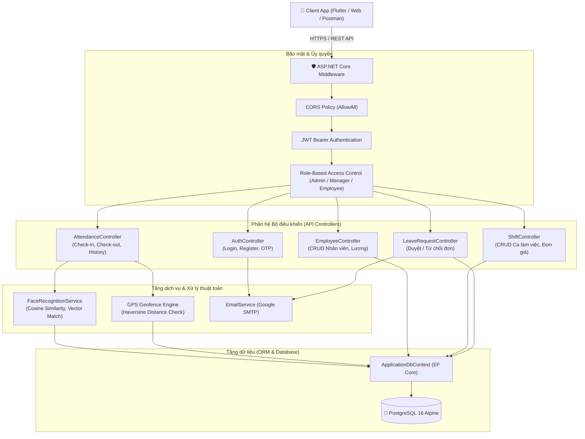

# 🏢 HỆ THỐNG CHẤM CÔNG THÔNG MINH - BACKEND RESTful WEB API

<div align="center">

-512BD4?logo=dotnet)


-F38020?logo=cloudflare)


**Máy chủ Backend RESTful Web API hiệu năng cao xây dựng trên nền tảng .NET 10 & PostgreSQL, cung cấp hạ tầng dữ liệu và nghiệp vụ cho Hệ thống Chấm công Thông minh đa phương thức: Nhận diện khuôn mặt AI Biometric, Định vị vệ tinh GPS Geofencing, Quét mã QR và Cảm biến ô nhiễm tiếng ồn môi trường.**

📱 **Kho lưu trữ Ứng dụng Di động & Web (Frontend Flutter):** [https://github.com/congnghip/LTDT_FE](https://github.com/congnghip/LTDT_FE)

</div>

---

## 📑 Mục lục
1. [Tổng quan hệ thống](#-tổng-quan-hệ-thống)
2. [Kiến trúc công nghệ](#-kiến-trúc-công-nghệ)
3. [Các phân hệ nghiệp vụ chính](#-các-phân-hệ-nghiệp-vụ-chính)
4. [Mô hình cơ sở dữ liệu (Database Schema)](#-mô-hình-cơ-sở-dữ-liệu-database-schema)
5. [Cấu trúc mã nguồn thư mục](#-cấu-trúc-mã-nguồn-thư-mục)
6. [Tài liệu API Endpoints (Swagger Reference)](#-tài-liệu-api-endpoints-swagger-reference)
7. [Hướng dẫn cài đặt & Khởi chạy](#-hướng-dẫn-cài-đặt--khởi-chạy)
8. [Triển khai Public HTTPS qua Cloudflare Tunnel](#-triển-khai-public-https-qua-cloudflare-tunnel)
9. [Cấu hình appsettings.json](#-cấu-hình-appsettingsjson)
10. [Tác giả & Giấy phép](#-tác-giả--giấy-phép)

---

## 🌟 Tổng quan hệ thống

Dự án **Sang6_WebAPI** đóng vai trò trung tâm điều phối dữ liệu và logic nghiệp vụ cho toàn bộ hệ sinh thái Chấm công Thông minh. Máy chủ cung cấp các chuẩn giao tiếp RESTful API an toàn, đáp ứng thời gian thực với độ trễ thấp và khả năng mở rộng cao.

### Điểm nổi bật:
- **Xác thực khuôn mặt AI Biometric:** Thuật toán tính độ tương đồng vector (Cosine Similarity) đối chiếu mẫu sinh trắc học khuôn mặt nhân viên lưu trong database với dung sai chính xác cao.
- **Tính toán khoảng cách GPS Geofencing:** Tích hợp công thức lượng giác mặt cầu (Haversine Formula) trên máy chủ nhằm tính bán kính thực tế giữa nhân viên và tọa độ doanh nghiệp, ngăn chặn hoàn toàn việc gian lận GPS giả (Mock Location).
- **Giám sát ô nhiễm tiếng ồn môi trường:** Thu nhận dữ liệu cường độ âm thanh Decibel (SPL dB), lưu vết lịch sử phục vụ phân tích điều kiện môi trường lao động theo tiêu chuẩn an toàn lao động OSHA.
- **Bộ tính lương và giờ công tự động (Live Salary Engine):** Tính toán chi tiết thời lượng ca làm việc, hệ số lương theo giờ, phụ cấp và khấu trừ đi muộn / về sớm theo thời gian thực.
- **Bảo mật đa tầng:** Sử dụng ASP.NET Core Identity, mã hóa mật khẩu PBKDF2, phân quyền theo vai trò (Role-Based Access Control - RBAC) và bảo vệ API bằng JWT Bearer Token.
- **Email Service tự động:** Tích hợp giao thức SMTP gửi mã OTP xác nhận tài khoản và thư thông báo duyệt đơn nghỉ phép tự động.

---

## 🏗 Kiến trúc công nghệ



### Công nghệ chính:
| Thành phần | Phiên bản / Thư viện | Mô tả |
|---|---|---|
| **Nền tảng** | **.NET 10.0 / C# 13** | Phiên bản runtime LTS hiệu năng cao nhất của Microsoft |
| **Framework** | **ASP.NET Core Web API** | Xây dựng RESTful API chuẩn quốc tế |
| **Database** | **PostgreSQL 16 Alpine** | Hệ quản trị cơ sở dữ liệu quan hệ mã nguồn mở mạnh mẽ |
| **ORM** | **Entity Framework Core 10 (Npgsql)** | Thao tác cơ sở dữ liệu theo mô hình Code-First / Migrations |
| **Bảo mật** | **Microsoft.AspNetCore.Identity** | Quản lý người dùng, mật khẩu băm, quản trị Claims & Roles |
| **Xác thực** | **JwtBearer (System.IdentityModel.Tokens.Jwt)** | Cấp phát và thẩm định JSON Web Token (JWT) |
| **Tài liệu hóa** | **Swagger / OpenAPI (Swashbuckle)** | Tự động sinh giao diện kiểm thử API tương tác trực tiếp |
| **Email** | **MailKit / System.Net.Mail** | Dịch vụ gửi email thông báo và mã OTP kích hoạt qua SMTP |

---

## ⚙️ Các phân hệ nghiệp vụ chính

### 1. Phân hệ Xác thực & Phân quyền (Auth & Identity)
- **Đăng ký tài khoản:** Nhân viên mới đăng ký với Email công ty. Hệ thống tự động tạo mã OTP gồm 6 chữ số ngẫu nhiên có hiệu lực trong 5 phút và gửi về hộp thư nhân viên.
- **Xác thực OTP:** Người dùng nhập mã OTP để kích hoạt tài khoản (`EmailConfirmed = true`).
- **Đăng nhập & Cấp phát JWT:** Kiểm tra mật khẩu, tạo chuỗi JWT ký điện tử bằng thuật toán `HmacSha256`, chứa các Claim định danh (`NameIdentifier`, `Email`, `Role`, `FullName`).
- **Đổi mật khẩu & Reset:** Hỗ trợ quy trình đổi mật khẩu bảo mật qua API.

### 2. Phân hệ Chấm công Đa phương thức (Smart Attendance)
- **Check-in / Check-out:** Ghi nhận đồng thời:
  - Thời điểm quẹt thẻ (Timestamp).
  - Tọa độ GPS (`Latitude`, `Longitude`).
  - Mức độ ồn môi trường làm việc (`NoiseLevelDb`).
  - Phương thức quẹt (`FACE`, `GPS`, `QR_CODE`).
  - Dữ liệu khuôn mặt đã qua kiểm chứng AI.
- **Tính toán khoảng cách GPS:**
  $$\Delta\sigma = 2 \arcsin \left( \sqrt{\sin^2\left(\frac{\Delta\varphi}{2}\right) + \cos\varphi_1 \cos\varphi_2 \sin^2\left(\frac{\Delta\lambda}{2}\right)} \right)$$
  $$d = R \cdot \Delta\sigma \quad (\text{với } R = 6.371.000\text{ m})$$
  Nếu $d > 100\text{m}$, hệ thống từ chối hoặc cảnh báo vị trí không hợp lệ.

### 3. Phân hệ Quản lý Ca làm việc (Shift Management)
- Thiết lập các ca làm việc trong ngày (Ca sáng, Ca chiều, Ca đêm).
- Cấu hình giờ bắt đầu, giờ kết thúc và đơn giá lương theo giờ (Hourly Wage).
- Quản lý trạng thái hoạt động (Active/Inactive) của từng ca trực.

### 4. Phân hệ Quản lý Nhân sự & Tiền lương (Employee & Payroll)
- Danh sách toàn bộ nhân sự, tra cứu theo tên, email, chức vụ.
- Thiết lập mức lương căn bản cho từng vị trí nhân viên.
- Thống kê tổng số giờ làm và ước tính tổng tiền lương tích lũy trong tháng.

### 5. Phân hệ Quản lý Đơn xin nghỉ phép (Leave Request Workflow)
- Nhân viên gửi đơn nghỉ phép kèm lý do (ốm đau, thai sản, việc cá nhân, phép năm) và khoảng thời gian.
- Quản lý (Manager) và Quản trị viên (Admin) xem xét phê duyệt (`Approved`) hoặc từ chối (`Rejected`).
- Tự động kích hoạt dịch vụ Email gửi kết quả phê duyệt về hòm thư nhân viên.

---

## 🗄 Mô hình cơ sở dữ liệu (Database Schema)

Hệ thống được thiết kế chuẩn hóa trên PostgreSQL với các thực thể cốt lõi:

```
┌─────────────────────────────────────────┐
│               AppUsers                  │
├─────────────────────────────────────────┤
│ Id (PK, text/uuid)                      │
│ UserName / Email (unique)               │
│ FullName (nvarchar)                     │
│ PasswordHash (text)                     │
│ EmailConfirmed (bool)                   │
│ BaseSalary (decimal)                    │
│ FaceData / FaceEmbedding (text/json)    │
│ IsActive (bool)                         │
└────────────────────┬────────────────────┘
                     │ 1
                     │
                     │ n
┌────────────────────┴────────────────────┐       n ┌───────────────────────────┐
│             Attendances                 │─────────│          Shifts           │
├─────────────────────────────────────────┤       1 ├───────────────────────────┤
│ Id (PK, int)                            │         │ Id (PK, int)              │
│ UserId (FK -> AppUsers.Id)              │         │ ShiftName (nvarchar)      │
│ ShiftId (FK -> Shifts.Id)               │         │ StartTime (time)          │
│ CheckInTime (timestamp)                 │         │ EndTime (time)            │
│ CheckOutTime (timestamp, nullable)      │         │ HourlyWage (decimal)      │
│ CheckInLat / CheckInLong (double)       │         │ IsActive (bool)           │
│ CheckOutLat / CheckOutLong (double)     │         └───────────────────────────┘
│ NoiseLevelDb (double)                   │
│ Method (varchar: FACE, GPS, QR)         │
│ FaceVerified (bool)                     │
└─────────────────────────────────────────┘
                     │ 1
                     │
                     │ n
┌────────────────────┴────────────────────┐
│            LeaveRequests                │
├─────────────────────────────────────────┤
│ Id (PK, int)                            │
│ UserId (FK -> AppUsers.Id)              │
│ Reason (nvarchar)                       │
│ FromDate (date)                         │
│ ToDate (date)                           │
│ Status (Pending, Approved, Rejected)    │
│ CreatedAt (timestamp)                   │
└─────────────────────────────────────────┘
```

---

## 📂 Cấu trúc mã nguồn thư mục

```plaintext
Sang6_WebAPI/
├── Controllers/                         # Tầng tiếp nhận và điều phối HTTP Request
│   ├── AttendanceController.cs          # API Check-in, Check-out, Lịch sử, Báo cáo tiếng ồn
│   ├── AuthController.cs                # API Đăng nhập, Đăng ký, Cấp JWT, Xác thực Email OTP
│   ├── EmployeeController.cs            # API Quản lý nhân viên (CRUD Employee, Cấu hình lương)
│   ├── LeaveRequestController.cs        # API Đơn xin nghỉ phép và Phê duyệt
│   └── ShiftController.cs               # API Quản lý ca làm việc (CRUD Shifts)
├── Data/
│   └── ApplicationDbContext.cs          # DbContext Entity Framework Core & Fluent API Mapping
├── Models/
│   ├── AppUser.cs                       # Kế thừa IdentityUser, mở rộng thuộc tính nhân viên
│   ├── Attendance.cs                    # Bản ghi lịch sử chấm công, tọa độ GPS, mức ồn dB
│   ├── Shift.cs                         # Ca làm việc và đơn giá theo giờ
│   ├── LeaveRequest.cs                  # Đơn xin nghỉ phép của nhân sự
│   └── DTOs.cs                          # Data Transfer Objects (Login, Register, CheckInRequest...)
├── Services/
│   ├── EmailService.cs                  # Dịch vụ gửi email thông báo & mã OTP qua Google SMTP
│   └── FaceRecognitionService.cs        # Thuật toán đối sánh vector khuôn mặt AI Biometric
├── Properties/
│   └── launchSettings.json              # Cấu hình cổng chạy máy chủ dev (Port 5000)
├── appsettings.json                     # Chuỗi kết nối Database, Khóa bảo mật JWT, Tài khoản SMTP
├── Dockerfile                           # Docker build đa tầng tối ưu cho .NET 10 Web API
├── Program.cs                           # Khởi tạo DI container, cấu hình Middleware, CORS, Swagger
├── Sang6_WebAPI.csproj                  # Khai báo gói thư viện NuGet của dự án .NET
└── Sang6_WebAPI.sln                     # File Visual Studio Solution
```

---

## 📡 Tài liệu API Endpoints (Swagger Reference)

Sau khi khởi chạy Backend, truy cập giao diện tương tác Swagger UI tại:
👉 `http://localhost:5000/` hoặc `http://localhost:5000/swagger`

### 1. Phân hệ Xác thực (Authentication)
| Method | Endpoint | Quyền hạn | Mô tả |
|:---:|---|:---:|---|
| `POST` | `/api/Auth/register` | Public | Đăng ký tài khoản nhân viên mới và tự động gửi mã OTP |
| `POST` | `/api/Auth/verify-otp` | Public | Xác thực mã OTP 6 số để kích hoạt tài khoản |
| `POST` | `/api/Auth/login` | Public | Đăng nhập với Email & Mật khẩu, trả về JWT Token |
| `POST` | `/api/Auth/resend-otp` | Public | Gửi lại mã OTP qua email |
| `POST` | `/api/Auth/change-password`| Bearer Token | Đổi mật khẩu tài khoản người dùng |

### 2. Phân hệ Chấm công (Attendance)
| Method | Endpoint | Quyền hạn | Mô tả |
|:---:|---|:---:|---|
| `POST` | `/api/Attendance/checkin` | Bearer Token | Chấm công vào ca (gửi GPS, FaceVerified, NoiseLevelDb) |
| `POST` | `/api/Attendance/checkout` | Bearer Token | Chấm công tan ca và tính toán giờ công hoàn thành |
| `GET` | `/api/Attendance/today` | Bearer Token | Kiểm tra trạng thái chấm công của nhân viên trong ngày |
| `GET` | `/api/Attendance/history` | Bearer Token | Tra cứu lịch sử chấm công cá nhân theo khoảng thời gian |
| `GET` | `/api/Attendance/all` | Admin/Manager | Xem toàn bộ lịch sử chấm công của công ty |

### 3. Phân hệ Nhân sự (Employee)
| Method | Endpoint | Quyền hạn | Mô tả |
|:---:|---|:---:|---|
| `GET` | `/api/Employee/all` | Admin/Manager | Danh sách tất cả nhân viên trong hệ thống |
| `GET` | `/api/Employee/{id}` | Admin/Manager | Lấy chi tiết thông tin nhân viên theo ID |
| `POST` | `/api/Employee` | Admin | Tạo mới hồ sơ nhân viên và gán quyền |
| `PUT` | `/api/Employee/{id}` | Admin | Cập nhật thông tin, chức vụ, lương cơ bản |
| `DELETE`| `/api/Employee/{id}` | Admin | Xóa tài khoản nhân viên khỏi hệ thống |

### 4. Phân hệ Ca làm việc (Shifts)
| Method | Endpoint | Quyền hạn | Mô tả |
|:---:|---|:---:|---|
| `GET` | `/api/Shift` | Bearer Token | Lấy danh sách các ca làm việc đang áp dụng |
| `POST` | `/api/Shift` | Manager/Admin | Thiết lập ca làm việc mới kèm đơn giá theo giờ |
| `PUT` | `/api/Shift/{id}` | Manager/Admin | Cập nhật thông tin ca làm việc |
| `DELETE`| `/api/Shift/{id}` | Manager/Admin | Xóa ca làm việc |

### 5. Phân hệ Đơn xin nghỉ phép (Leave Requests)
| Method | Endpoint | Quyền hạn | Mô tả |
|:---:|---|:---:|---|
| `POST` | `/api/LeaveRequest/create` | Bearer Token | Nhân viên gửi đơn xin nghỉ phép |
| `GET` | `/api/LeaveRequest/my-requests` | Bearer Token | Danh sách đơn xin nghỉ cá nhân |
| `GET` | `/api/LeaveRequest/all` | Admin/Manager | Toàn bộ danh sách đơn xin nghỉ chờ xử lý |
| `PUT` | `/api/LeaveRequest/approve/{id}` | Admin/Manager | Phê duyệt hoặc từ chối đơn xin nghỉ phép |

---

## 🛠 Hướng dẫn cài đặt & Khởi chạy

### 1. Yêu cầu môi trường
- [.NET SDK 10.0](https://dotnet.microsoft.com/download) (hoặc .NET 8.0+).
- [PostgreSQL](https://www.postgresql.org/) chạy ở cổng mặc định `5432`.
- [Docker & Docker Compose](https://www.docker.com/) (nếu chạy dạng Container).

---

### Cách 1: Khởi chạy nhanh bằng Script tự động (Windows)
1. Đảm bảo dịch vụ PostgreSQL đang chạy trên máy tính.
2. Click đúp vào file script tự động:
   ```cmd
   Chay_Backend_WebAPI.bat
   ```
3. Script sẽ tự động khôi phục thư viện, kiểm tra kết nối và khởi động Web API tại `http://localhost:5000`.

---

### Cách 2: Khởi chạy thủ công từ Command Line
```bash
# 1. Di chuyển vào thư mục backend
cd Sang6_WebAPI

# 2. Khôi phục các gói thư viện NuGet
dotnet restore

# 3. Cập nhật cơ sở dữ liệu Entity Framework (Migration)
dotnet ef database update

# 4. Khởi chạy máy chủ API
dotnet run --urls "http://0.0.0.0:5000"
```

---

### Cách 3: Khởi chạy bằng Docker Compose
Chỉ với 1 lệnh duy nhất để tạo cụm PostgreSQL và Backend API:
```bash
docker-compose up -d --build
```
- **Web API Endpoint:** `http://localhost:5000`
- **PostgreSQL Database:** `localhost:5432`

---

### Cách 4: Triển khai trực tiếp lên Vercel (Container Runtime / Fluid Compute)
Backend đã được tích hợp sẵn file `Dockerfile.vercel` và `vercel.json` tối ưu cho runtime container của Vercel:
1. Đăng nhập vào [Vercel Dashboard](https://vercel.com) và bấm **Add New...** ➔ **Project** ➔ Chọn kho lưu trữ [congnghip/LTDT_BE](https://github.com/congnghip/LTDT_BE).
2. Vercel tự động nhận diện `Dockerfile.vercel` và kích hoạt **Vercel Serverless Container**.
3. Cấu hình biến môi trường kết nối Database trong mục **Environment Variables**:
   - `ConnectionStrings__DefaultConnection`: Chuỗi kết nối PostgreSQL trên đám mây (Neon, Supabase, hoặc Railway PostgreSQL).
   - `JWTKey__Secret`: Chuỗi khóa ký JWT Token.
4. Bấm **Deploy**. Vercel sẽ tự động build container .NET 10 và cấp phát domain HTTPS toàn cầu.

---

## 🌐 Triển khai Public HTTPS qua Cloudflare Tunnel

Để điện thoại di động thật (chạy 4G/Wi-Fi bên ngoài) có thể gọi trực tiếp vào API localhost mà không cần mở cổng modem (Port Forwarding), dự án cung cấp script tạo **Cloudflare Tunnel HTTPS miễn phí**:

1. Click đúp vào file:
   ```cmd
   Chay_Cloudflare_Tunnel.bat
   ```
2. Cloudflare sẽ sinh tự động một đường link an toàn dạng:
   ```text
   https://xxxx-xxxx-xxxx.trycloudflare.com
   ```
3. Dán URL này vào cấu hình `BASE_URL` của Frontend Flutter ([LTDT_FE](https://github.com/congnghip/LTDT_FE)):
   ```env
   BASE_URL=https://xxxx-xxxx-xxxx.trycloudflare.com/api/
   ```
4. Kiểm tra Swagger UI trực tiếp trên mọi thiết bị thông qua đường hầm:
   `https://xxxx-xxxx-xxxx.trycloudflare.com/`

---

## ⚙️ Cấu hình appsettings.json

File `Sang6_WebAPI/appsettings.json` cho phép tinh chỉnh các thông số hệ thống:

```json
{
  "JWTKey": {
    "Secret": "AReallyLongSecretKeyForYourJWTTokenSigning1234567890!",
    "ValidIssuer": "BuiNguyenCongNghiep_API",
    "ValidAudience": "BuiNguyenCongNghiep_Client",
    "TokenExpiryTimeInHour": "24"
  },
  "EmailSettings": {
    "SmtpServer": "smtp.gmail.com",
    "Port": 587,
    "SenderEmail": "your-email@gmail.com",
    "SenderName": "Hệ Thống Chấm Công Thông Minh",
    "Password": "your-app-password",
    "EnableSsl": true
  },
  "ConnectionStrings": {
    "DefaultConnection": "Host=localhost;Port=5432;Database=buinguyencongnghiep_chamcong;Username=postgres;Password=admin"
  }
}
```

---

## 👤 Tác giả & Giấy phép

- **Sinh viên thực hiện:** Bùi Nguyễn Công Nghiệp
- **GitHub:** [@congnghip](https://github.com/congnghip)
- **Email:** buinguyencongnghiep04@gmail.com
- **Đơn vị:** Khoa Công nghệ Thông tin - Trường Đại học Công nghệ TP.HCM (HUTECH)
- **Học phần:** Lập Trình Thiết Bị Di Động (LTDD)

Dự án được phân phối theo giấy phép mã nguồn mở [MIT License](LICENSE).
